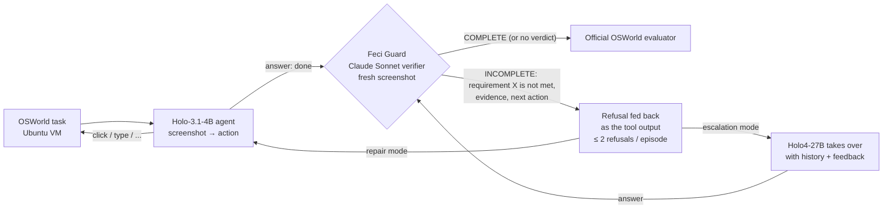

# Cogito, Ergo Feci: catching the false "done" of a computer-use agent

[](https://github.com/martinbon39/ComputerUseHackaton/actions/workflows/quickstart.yml)

**H Company × 42AI hackathon, Computer Use track.** We diagnosed why H's computer-use agent **Holo-3.1-4B** says
"task done" when it is not. The fix is not in its weights. It is an external verifier, **Feci Guard**, that checks
every requirement on the screen, refuses a false "done" with a reason, and can hand the task to a stronger agent (Holo4).

> **Judges in a hurry:** run the 3-command [quickstart](#quickstart-under-5-minutes-no-gpu-no-key-no-vm) (no GPU, no
> key, no VM). It recomputes our headline numbers and replays the Guard on 268 recorded episodes. Then read the
> [criterion → evidence table](#hackathon-criteria--where-the-evidence-is). AI reviewers: start with [AGENTS.md](AGENTS.md).

Résumé en français : [plus bas](#résumé-en-français).

---

## The problem: agents that lie about being done

A computer-use agent that stops early and says "done" is worse than one that fails loudly: the user trusts it and
moves on. On 120 real OSWorld desktop tasks (Ubuntu VMs, official evaluators), Holo-3.1-4B succeeds on 66 of 119 scored tasks
(55.5 %; mean score 56.7 % with partial credit). **29 of its 51 failures (57 %) are a false "done"**: it calls `answer` and the official evaluator gives 0.
Source: [`holo-neurochir/paper/generated/num_osw_diag.tex`](holo-neurochir/paper/generated/num_osw_diag.tex), paper §3.

## The diagnosis: the information is not in the model

We first tried to repair the stopping decision inside the model, without training. The work ran from 7 to 8 November 2026,
with ~25 agents, pre-registered gates and adversarial reviews. Together the results say the agent **does not internally know** that
its "done" is false:

- **Holo judging its own final screen is at chance.** It flags 53 % of false successes and also rejects 48 % of true
  ones (gap +5 pts, CI [−13, +23], 268 episodes). The larger Holo4-27B does little better (+16 [−3, +33]).
  [`judge_bench/REPORT.md`](holo-neurochir/judge_bench/REPORT.md), [`verif_study/`](holo-neurochir/verif_study/)
- **Internal states do not separate false from true "done" better than the step number does.** A false-success
  direction in the activations adds at most 0.04 AUROC over position. Text signals reach AUROC 0.66, against 0.72 for
  the step index. [`text_signal/REPORT.md`](holo-neurochir/text_signal/REPORT.md), paper §4.
- **Weight surgery moves the decision but cannot aim it.** A closed-form edit and a weight merge lower `answer` on
  false successes. They lower it as much on true finishes (15/16 → 3/16), so the edits have no discriminator. Online, no edit beats the
  noise of the original. Merge vs original, 165 paired tasks: **+1.9 pts, CI95 [−4.3, +8.0]**, so no gain is
  claimed. About 15 other weight- and activation-edit experiments were screened and rejected. They are listed in [docs/REPO_MAP.md](docs/REPO_MAP.md).

If the information is not in the agent, it has to come from outside. That is the design of Feci Guard.

## The solution: Feci Guard, then repair, then escalation



- **Guard** ([`holo-neurochir/feci_guard/`](holo-neurochir/feci_guard/)): on every `answer`, a stronger model lists every
  requirement of the task, marks each one yes / no / cannot_tell with visual evidence, and returns strict JSON. The
  only accept/reject rule is in [`feci_guard.py`](holo-neurochir/feci_guard/feci_guard.py) (61 lines, frozen). It
  records the hash of the verifier it calls (`verifier.py`, sha256 prefix `0af76fdb`) in every verdict. A broken or slow verifier never blocks the agent: no verdict means the answer passes.
- **Repair**: the refusal goes back to the agent as the tool's output: *"Verifier: requirement 'Rental dates must be
  Dec 10–11' is not satisfied on screen: … Click Modify Rental Details … Continue the task."*
- **Escalation**: after a refusal, Holo4-27B (served on Modal) continues the episode with the history and the feedback.
  Code: [`run_holo_guard_rescue.py`](holo-neurochir/feci_guard/run_holo_guard_rescue.py); measurement in progress
  ([PR #1](https://github.com/martinbon39/ComputerUseHackaton/pull/1)).
- **Use it in any agent loop** (one call, synchronous, never raises, < 60 s):
  ```python
  import sys; sys.path.insert(0, "holo-neurochir/feci_guard"); import feci_guard
  r = feci_guard.check(task_instruction, screenshot_png_bytes)
  if r["verdict"] == "reject":          # INCOMPLETE with at least one requirement visibly "no"
      tool_output = r["feedback"]       # tell the agent what is missing, and continue the episode
  # r["requirements"]: [{"text", "status": "yes" | "no" | "cannot_tell", "evidence"}] for the episode journal
  ```
- **Backends**: local `claude -p` CLI, or any OpenAI-compatible endpoint (`GUARD_BACKEND=openai`), so it also runs on
  GitHub-hosted runners ([holo-osworld-runner](https://github.com/martinbon39/holo-osworld-runner)).

## Results

Every gain claim follows one rule, fixed before the results were read: **a gain is claimed only if the lower bound of
the paired 95 % CI is > 0.** n is always the denominator shown. Intervals are a task-level paired bootstrap (10 000
resamples, seed 0) for differences, and Wilson intervals for proportions.

| # | Question | Result (n, 95 % CI) | Verdict | Reproduce / source |
|---|---|---|---|---|
| 1 | How often is a failure a false "done"? | 29/51 failures (57 %); success 66/119 (55.5 %) | measured | [`num_osw_diag.tex`](holo-neurochir/paper/generated/num_osw_diag.tex) |
| 2 | Can Holo judge its own "done"? (268 final screens from 90 tasks) | detects 35/66 (53 % [41–65]), wrongly rejects 97/202 (48 % [41–55]); gap +5 [−13, +23] | **no** (chance) | `python3 jury_kit/recount_judges.py` |
| 3 | Weight merge vs original, OSWorld online | +1.94 pts [−4.3, +8.0], n=165 paired tasks (18 wins / 14 losses) | **no detectable gain** | `python3 jury_kit/verify_results.py` |
| 4 | Closed-form edit (AlphaEdit) online | +2.2 pts [−13.3, +17.8], n=45 | no detectable gain | same script |
| 5 | ExPO extrapolation online | −1.5 pts [−8.9, +5.7], n=120 | no detectable gain | same script |
| 6 | Noise floor: same model, two servers | +1.5 pts [−4.5, +7.6], n=120 | reference | same script |
| 7 | Feci Guard verifier, offline, same 268 episodes (90 tasks) | detects **45/66 (68 % [56–78])**, wrongly rejects **21/202 (10 % [7–15])**; gap **+58 [+41, +74]** | **separates** | `python3 jury_kit/replay_guard.py` |
| 8 | Guard repair on replayed false successes | 5/18 vs 2/18 branches repaired (9 episodes × 2); +16.7 pts [0, +44], sign test p=0.5 | **not distinguishable from 0** | [`feci_guard/RESULTS.md`](holo-neurochir/feci_guard/RESULTS.md) |
| 9 | Guard + escalation to Holo4, vs Holo4 alone (replayed false successes, same boundary) | interim, 5 strict-valid episodes × 2: **4/10 vs 0/10** repaired, +0.40 [0, 0.80] (cluster CI); two repairs independently audited (`calc/37608790`, `impress/70bca0cc`) | **running**, numbers will move | [`rescue_bench/REPORT.md` in PR #1](https://github.com/martinbon39/ComputerUseHackaton/pull/1) |
| 10 | Holo + Guard on the 120-task OSWorld test split, vs the same model on the same server | pre-registered; first launch lost to a pod outage with 0 tasks played (amendment 2), relaunched on Modal at 09:50 UTC | **running**, no result yet | [`report/PREREG_ONLINE_GUARD.md`](holo-neurochir/report/PREREG_ONLINE_GUARD.md) |
| 11 | Stronger judge: Guard v2 (Opus + the 2 previous screens + action list) vs v1, held-out half used once | detects 20/29 (69 %) vs 16/29 (55 %): **+13.8 pts [+2.9, +30]**; false rejection 15/116 (12.9 %) vs 10/116 (8.6 %): +4.3 [−5, +15] | **more detection, significant**; the target (≥ 80 % detection, ≤ 10 % false rejection) is **not met**; offline only | [`feci_guard/RESULTS.md`](holo-neurochir/feci_guard/RESULTS.md#guard-v2-sprint-s1-offline-judge_bench-corpus-v2protocolmd-independently-recomputed), [`v2/PROTOCOL.md`](holo-neurochir/feci_guard/v2/PROTOCOL.md) |

Caveats that change how to read the table:
- Row 7: the Holo judges used a different prompt than the Claude verifier, so the gap mixes model and prompt
  ([`judge_bench/REPORT.md`](holo-neurochir/judge_bench/REPORT.md), Limits). The verifier sees one final screen: it
  cannot see a saved file. On `impress/550ce7e7` it fixed what was visible and the evaluator still scored 0
  ([`smoke/impress_550ce7e7_guard.md`](holo-neurochir/feci_guard/smoke/impress_550ce7e7_guard.md)).
- Rows 3–6: our OSWorld harness is more permissive than H's official adapter on infeasible tasks. Absolute scores are
  not comparable with H's published ones. Only paired comparisons are meaningful.
- Row 8 measures refusal **plus coaching** (the feedback contains a suggested next action). 7 of the 12 refused
  branches ran out of steps without answering again.

## Quickstart (under 5 minutes, no GPU, no key, no VM)

Python ≥ 3.9, standard library only. Nothing to install.

```bash
git clone https://github.com/martinbon39/ComputerUseHackaton && cd ComputerUseHackaton
python3 jury_kit/verify_results.py          # (a) recompute rows 3-6 from 660 per-task scores (8 arm × split runs); checks +1.94/+0.18/+6.64
python3 jury_kit/replay_guard.py --show 2   # (b) replay Feci Guard on 268 recorded episodes; checks 45/66, 21/202
python3 jury_kit/recount_judges.py          #     recount the 3 judges (rows 2, 7) from their raw recorded responses
bash jury_kit/quickstart.sh                 # all of the above + (c), exit code 0 = all published numbers reproduced
```

- **(a)** [`jury_kit/verify_results.py`](jury_kit/verify_results.py) reads [`jury_kit/results/scores.csv`](jury_kit/results/scores.csv)
  (one row per task, arm and split) and recomputes every paired comparison with a fixed-seed bootstrap. It prints
  the primary verdict: *"Lower bound = −4.3 pt → NO DETECTABLE GAIN"*.
- **(b)** [`jury_kit/replay_guard.py`](jury_kit/replay_guard.py) runs the **frozen** `feci_guard.check` on each
  episode's real final screenshot (sha256-checked) and swaps only the network call for the verdict Claude returned
  on 2026-11-08. It scores the decisions against the official OSWorld labels. `--show N` prints the refusals the
  agent would have received. [`jury_kit/recount_judges.py`](jury_kit/recount_judges.py) recounts all three judges
  (Holo-3.1-4B, Holo4-27B, Claude) from their raw responses, as the independent recount did during the hackathon.
- **(c)** Demo replay: open [`holo-neurochir/demo_faux_fini/demo_faux_fini.html`](holo-neurochir/demo_faux_fini/demo_faux_fini.html)
  in a browser (one self-contained 3 MB file, or `python3 -m http.server -d holo-neurochir/demo_faux_fini`). It
  replays a recorded episode step by step: the original agent's false "done" on a real desktop. This is one illustrative episode, not evidence of a
  gain. Screenshots of the live duel page (two VMs side by side, STOP buttons, recorded verdicts):
  [`osworld/duel/shots/`](holo-neurochir/osworld/duel/shots/).

Expected outputs, pasted from a fresh clone: [docs/QUICKSTART_PROOF.md](docs/QUICKSTART_PROOF.md). The same script
runs in GitHub Actions whenever the jury kit, the Guard code or its data change ([`.github/workflows/quickstart.yml`](.github/workflows/quickstart.yml)).

## Level 2: the Guard for real on a screenshot (Claude CLI or Anthropic key, ~$0.03)

```bash
python3 jury_kit/guard_live.py                          # uses the `claude` CLI (Claude Code, logged in)
pip install openai && ANTHROPIC_API_KEY=... python3 jury_kit/guard_live.py --api   # or an API key
python3 jury_kit/guard_live.py --list                   # 268 episode ids, label, recorded verdict
python3 jury_kit/guard_live.py --episode <id>           # any of them
```
It makes a fresh verifier call on a recorded final screen and compares the live decision with the recorded one. We ran
the CLI path ([proof](docs/QUICKSTART_PROOF.md#level-2)). We did not run the `--api` path: we had no key on the
machine. Manual check on any image: `python3 holo-neurochir/feci_guard/verifier.py --task "<instruction>" --image shot.png`.

Model-side checks of the weight edits (download, ~40 GB disk, GPU for the probe):
[`jury_kit/README.md`](jury_kit/README.md) levels 2–3. They rebuild the merged checkpoint bit-for-bit from three pinned
public models, and replay 4 frozen contexts.

## Level 3: full OSWorld (VMs, GitHub runners, Modal)

- **Episodes on GitHub-hosted runners**: [martinbon39/holo-osworld-runner](https://github.com/martinbon39/holo-osworld-runner)
  runs OSWorld VMs (KVM) in GitHub Actions jobs, 20 shards in parallel. The agent is served by vLLM on Modal, and the Guard is
  reached through an OpenAI-compatible relay. Collection: [`osworld/gh_collect.sh`](holo-neurochir/osworld/gh_collect.sh).
- **Serving the models**: [`osworld/MODAL.md`](holo-neurochir/osworld/MODAL.md),
  [`osworld/MODAL_MANIFEST.md`](holo-neurochir/osworld/MODAL_MANIFEST.md) (deploy manifests with sha256), cost log
  [`osworld/MODAL_COST.md`](holo-neurochir/osworld/MODAL_COST.md).
- **Guard in an episode**: `bash holo-neurochir/feci_guard/run_guard.sh <out> <tasks.json> <workers>`; escalation:
  `run_guard_rescue.sh`; paired analysis: `compare_online.py` ([`feci_guard/README.md`](holo-neurochir/feci_guard/README.md)).
- **Live duel** (original vs modified agent, same task, two VMs, STOP buttons, replay of any recorded duel):
  [`osworld/duel/README.md`](holo-neurochir/osworld/duel/README.md).

These need an OSWorld setup (VM images, ~40 GB), a vLLM endpoint and a verifier backend. We ran them on our server and
on GitHub runners. A judge cannot run them in 5 minutes.

## Hackathon criteria → where the evidence is

| Criterion (weight) | What we show | Evidence in this repo |
|---|---|---|
| **Use of Computer Use (25 %)** | H's computer-use agent on real Ubuntu desktops (OSWorld, KVM VMs, official evaluators), 660 paired online task scores, 268 labelled final screens; a verifier that reads the screen; a live duel of two agents on two VMs | [`jury_kit/results/scores.csv`](jury_kit/results/scores.csv) (660 paired task scores), [`verif_study/images/`](holo-neurochir/verif_study/images/) (268 final screens), [`osworld/duel/`](holo-neurochir/osworld/duel/), [holo-osworld-runner](https://github.com/martinbon39/holo-osworld-runner) |
| **Technical execution & reliability (25 %)** | End-to-end pipeline (VMs, vLLM on Modal, GitHub runners, paired evaluation); checkpoint rebuilt bit-for-bit; frozen decision code with a hash; a CI job that reproduces the numbers whenever their inputs change | [`jury_kit/`](jury_kit/), [`.github/workflows/quickstart.yml`](.github/workflows/quickstart.yml), [`jury_kit/expected_sha256.json`](jury_kit/expected_sha256.json), [`feci_guard/feci_guard.py`](holo-neurochir/feci_guard/feci_guard.py), [docs/QUICKSTART_PROOF.md](docs/QUICKSTART_PROOF.md) |
| **Usefulness & impact (20 %)** | The false "done" is the main failure mode (57 % of failures). A verifier that catches 68 % of them at a 10 % false-alarm rate can be added to any agent through one function call, `feci_guard.check(task, png)` | rows 1 and 7 above, [`feci_guard/README.md`](holo-neurochir/feci_guard/README.md), [paper](holo-neurochir/paper/main.pdf) |
| **Originality & innovation (15 %)** | First weight-surgery study of a GUI agent's stopping decision, with three traps that would each have produced a false positive; a negative result that motivates the external verifier; an autonomous agent research team | [paper](holo-neurochir/paper/main.pdf) §4–6, [docs/REPO_MAP.md](docs/REPO_MAP.md), [How we worked](#how-we-worked) |
| **UX & user control (10 %)** | The refusal says *which* requirement failed and *what* to do; ≤ 2 refusals so the agent is never stuck; a failing verifier never blocks; a readable journal per episode (`guard.md`, ✓/✗ per requirement); the duel page has STOP buttons and step-by-step replay | [`smoke/impress_550ce7e7_guard.md`](holo-neurochir/feci_guard/smoke/impress_550ce7e7_guard.md), [`osworld/duel/shots/`](holo-neurochir/osworld/duel/shots/) |
| **Demo clarity & Q&A (5 %)** | 3-command quickstart, a demo replay page, a paper with every number regenerated from data | [Quickstart](#quickstart-under-5-minutes-no-gpu-no-key-no-vm), [`demo_faux_fini.html`](holo-neurochir/demo_faux_fini/demo_faux_fini.html), [`paper/README.md`](holo-neurochir/paper/README.md) |

## Links

- **Paper**: *Cogito, Ergo Feci: False Success and the Limits of Weight Surgery in a Computer-Use Agent*.
  [arXiv-style PDF](holo-neurochir/paper/main.pdf) · [NeurIPS-format PDF](holo-neurochir/paper/neurips.pdf) (with the filled
  reproducibility checklist). Every number is regenerated from `paper/data/` by `paper/build.sh`. Hosted copies:
  [arXiv-style](https://argos.martinbonan.com/artifacts/holo-paper.pdf?t=mxejdbei.e3VHNdhebV_SJ8R0wLl3xTjkUyMV-i1O) ·
  [NeurIPS-format](https://argos.martinbonan.com/artifacts/holo-paper-neurips.pdf?t=mxejdbgj.RgncRPbt6dqkr8uMBww4pW_vSoe45k5K).
- **Demo replay page** (hosted copy): [holo-demo-faux-fini.html](https://argos.martinbonan.com/artifacts/holo-demo-faux-fini.html?t=mxec08h4.ypUQurEtCFn45XOw47vn5eHhOEl5Gyfd)
- **Agent runner**: [martinbon39/holo-osworld-runner](https://github.com/martinbon39/holo-osworld-runner)
- **Model studied**: [Hcompany/Holo-3.1-4B](https://huggingface.co/Hcompany/Holo-3.1-4B) @ `8c88265a`

## How we worked

The research was run by a team of AI agents (Claude Code sessions on one server, linked on a supervision canvas) that
one human supervised:
- **An orchestrator** (`ares`) set the questions, kept the budget (GPU, Modal dollars), froze the task splits and owned
  every online run. **Workers** each took one sub-question (one weight-edit family, one benchmark), with an iteration
  cap and a stop rule written before they started (for example "two rounds without progress → stop").
- **Pre-registration.** Gates and decision rules were committed before the data they judge
  ([`report/PREREG_ONLINE_GUARD.md`](holo-neurochir/report/PREREG_ONLINE_GUARD.md),
  [`feci_guard/PREREG.md`](holo-neurochir/feci_guard/PREREG.md), [`feci_guard/v2/PROTOCOL.md`](holo-neurochir/feci_guard/v2/PROTOCOL.md)).
  Amendments are dated and say what had been seen when they were written.
- **Maker ≠ checker.** Every result was recomputed by an agent that did not produce it (for example
  [`judge_bench/independent_recompute.py`](holo-neurochir/judge_bench/independent_recompute.py)), and adversarial
  reviewers attacked the conclusions. Reviews caught, among others, a replay drift that would have counted as a
  repair, and a noise level between two servers as large as our best "gain" (row 6).
- **Negative results are kept.** [docs/REPO_MAP.md](docs/REPO_MAP.md) lists every experiment folder, its status
  (result, negative, abandoned) and its source-of-truth file.

## Limitations

- One agent (Holo-3.1-4B), one benchmark (OSWorld), our harness (more permissive than the official adapter on
  infeasible tasks). Small n for repair (9 episodes) and escalation (in progress).
- The verifier sees the screen only. It cannot check file contents or saved settings; an "active" mode that asks the
  agent to make them visible exists but is not measured.
- The Guard costs ~$0.03 and 5–10 s per `answer`, and relies on a closed model (Claude Sonnet).
- The offline verifier comparison mixes prompt and model (row 7 caveat).
- Rows 9–10 are still running at the time of writing. Read the linked files for their final state.

## Acknowledgements and license

Thanks to H Company for Holo-3.1-4B and Holo4, to 42AI for the hackathon, and to the OSWorld authors (xlang-ai) for
the benchmark and evaluators. Merges use the public `Qwen/Qwen3.5-4B` and
`OnAnOrange/CUA-Lite-Qwen3.5-4B-ScaleCUA-gpt5_5-epoch3-public`.
Code and data in this repository: Apache-2.0 ([LICENSE](LICENSE)). Models keep their own licenses.

---

## Résumé en français

**Le problème.** L'agent de computer use de H, Holo-3.1-4B, dit souvent « fini » alors que la tâche n'est pas faite.
Sur 120 tâches OSWorld (vrais bureaux Ubuntu, évaluateurs officiels), **29 de ses 51 échecs (57 %) sont un faux
« fini »**.

**Le diagnostic.** L'information n'est pas dans le modèle. Holo juge son propre écran final au hasard : il détecte
53 % des faux succès et rejette aussi 48 % des vrais. Ses états internes ne séparent pas mieux les faux « fini » des
vrais que le numéro du pas. Les éditions de poids (fusion, AlphaEdit et une quinzaine d'autres expériences) déplacent la
décision d'arrêt sans pouvoir la viser. En ligne, fusion contre original sur 165 tâches appariées : +1,9 point,
IC95 [−4,3 ; +8,0], donc aucun gain n'est revendiqué (règle fixée avant de lire les résultats).

**La solution.** Feci Guard est un vérificateur externe (Claude Sonnet). À chaque « fini », il liste les exigences
de la tâche, vérifie chacune sur l'écran, refuse le faux « fini » en disant ce qui manque, puis l'agent répare ou
passe la main à Holo4-27B. Hors ligne, sur les mêmes 268 épisodes, il détecte 68 % des faux succès [56–78] pour 10 %
de vrais rejetés à tort [7–15]. La réparation (5/18 contre 2/18) ne se distingue pas encore de zéro. L'escalade vers
Holo4 et le test en ligne sur 120 tâches sont en cours. Un juge plus fort (Opus avec l'historique des écrans)
détecte 69 % des faux succès contre 55 % sur une moitié réservée utilisée une seule fois (+13,8 points [+2,9 ; +30]).

**Vérifier en 5 minutes, sans GPU ni clé** : `python3 jury_kit/verify_results.py`, `python3 jury_kit/replay_guard.py`,
`bash jury_kit/quickstart.sh`. Papier : [`holo-neurochir/paper/main.pdf`](holo-neurochir/paper/main.pdf).
